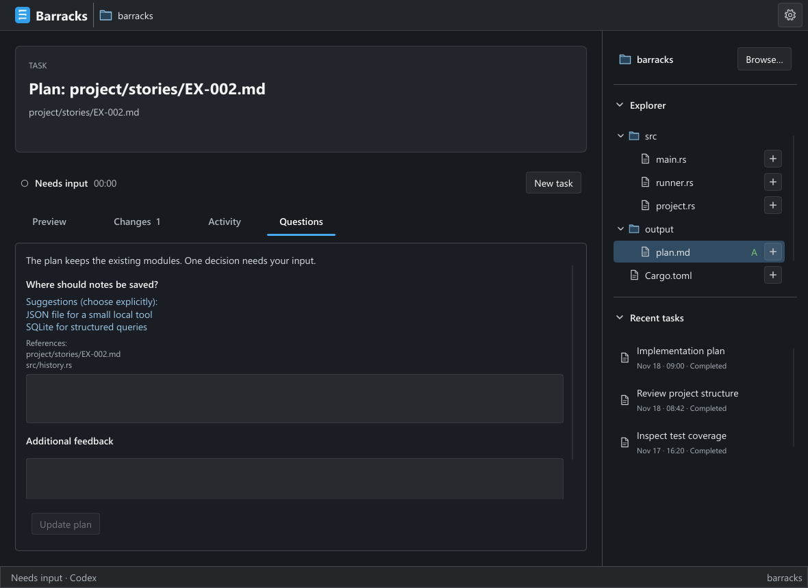

# Barracks

Barracks is a Windows desktop app for working on a codebase with Codex or Claude Code. Run a focused task, inspect its file changes, or turn an issue into an implementation plan through guided questions.

The first built-in operation is **Plan Work for Issue**, available as `/plan`. You can also enter ordinary task instructions.

## Get started

Barracks currently builds from source. The desktop workflow is tested on Windows.

### 1. Install the prerequisites

You need:

- **Git** to clone the repository.
- **Rust and Cargo**, installed through [rustup](https://rust-lang.org/tools/install/). Use the current stable toolchain and complete the Windows C++ build tools setup when prompted.
- **One supported AI command-line tool:** [Codex CLI](https://developers.openai.com/codex/cli/) or [Claude Code](https://code.claude.com/docs/en/quickstart).

Run your chosen AI tool in a terminal first. Complete sign-in and any initial project setup, and confirm that `codex` or `claude` is available on your PATH. Barracks uses that tool's existing account, model, and permission settings.

### 2. Build and launch Barracks

Open PowerShell and run:

```powershell
git clone https://github.com/nothingalike/barracks.git
cd barracks
cargo run --locked
```

The first launch downloads the Rust dependencies and builds the app. Later launches reuse the build.

### 3. Run your first task

1. Click **Browse** and choose the project repository you want to work on.
2. Open the **gear** button and choose Codex or Claude Code.
3. Enter a task in **Instructions**. For a first run, try:

   ```text
   Summarize this project and identify its main entry points.
   ```

4. Click **Run task**. **Activity** shows progress as the tool works.
5. When it finishes, read the summary in **Preview**.

To provide specific files as context, use **Add files**, click the **+** beside a file in Explorer, or drag a file onto Instructions. Attached files must belong to the selected project.

## Plan an issue

Use `/plan` when you want to work through implementation decisions before changing code.

1. Type `/` in Instructions and choose **Plan Work for Issue**.
2. Enter an issue file or issue reference in the target field.
3. Click **Start planning**.

You can also enter the command directly. Replace the example path with an issue in your selected project:

```text
/plan issues/add-search.md
Keep the current database and API.
```

The first line selects the issue. Later lines provide optional direction. File paths are relative to the selected project.

Barracks creates or updates a Markdown plan, then pauses when it needs your input:

1. Open **Questions** to review the questions, suggestions, and references. Suggestions remain unselected until you answer.
2. Enter your answers or additional feedback. You can answer some questions and leave others for later.
3. Click **Update plan** to apply your input and revise the plan.
4. When the status reads **No remaining questions**, review the plan in **Preview**. Supply a new direction to revise it further, or click **Finish operation**.



Plans are saved inside your project under `output/plans/`. Planning finishes when you choose **Finish operation**; implementation is a separate task.

Your draft answers are saved as you edit. **New task** pauses planning, and **Resume planning** brings it back. To continue after closing the app, select the same project folder again.

## Find your way around

| Area | Use it to |
| --- | --- |
| **Preview** | Read the task result, plan, or a file selected in Explorer. Code previews include syntax colors. |
| **Changes** | Inspect the files observed as added, updated, or removed during a run, with text comparisons where available. |
| **Activity** | Follow the work as it happens. The view returns to the newest event as new activity arrives. |
| **Questions** | Answer the current planning operation's questions and submit feedback. This tab appears during planning. |
| **Explorer** | Browse the selected project, preview files, and attach context. |
| **Recent tasks** | Reopen saved results and artifact snapshots, including while another task runs. |

**Copy** copies the displayed text. **Open file** tries VS Code first, then falls back to Notepad on Windows. **Task result** returns from a file preview to the tool's original response.

Use **Stop** to cancel a running task. File changes already made remain in the project. Read **Changes** before deciding what to keep.

## If something gets stuck

| What you see | What to do |
| --- | --- |
| The AI tool cannot start | Confirm that `codex` or `claude` runs from a new terminal. Restart Barracks after installing a CLI or changing PATH. |
| Sign-in, trust, or permission errors | Run the chosen CLI in your project folder and complete its setup there. Then retry in Barracks. Interactive CLI approval prompts are handled in the terminal. |
| **Interrupted** planning | Select the same project, open **Questions**, and choose **Retry step**. Saved answers remain available. |
| An invalid planning checkpoint | Review Activity and the error shown in Questions, then choose **Retry step**. The previous plan and pending answers are preserved. |
| A file cannot be attached | Choose a UTF-8 text file inside the project, up to 1 MiB. |

## Build and development

For a release build:

```powershell
cargo build --release --locked
```

The Windows executable is written to `target/release/barracks.exe`.

See the [development reference](docs/development.md) for test commands, local storage paths, execution behavior, and current limits.
